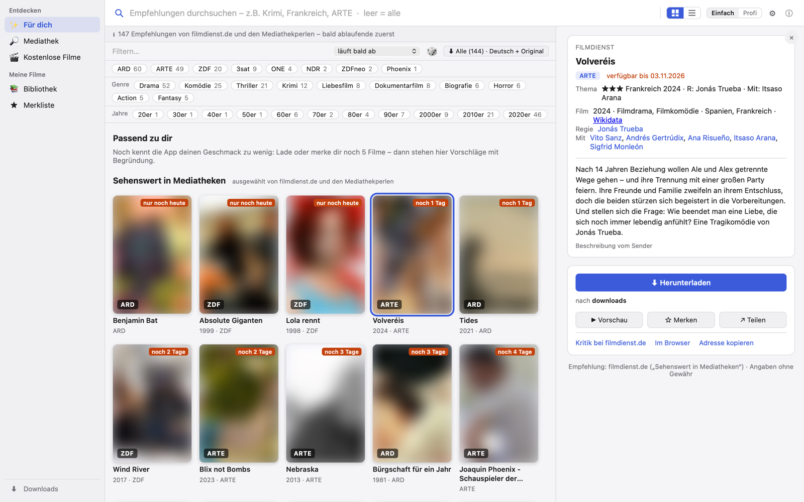

# Mediathek Plus

**Entdecken. Laden. Teilen.** Filme und Serien aus ARD, ZDF, ARTE, 3sat … finden, bevor sie verschwinden – für Mac, Windows und Linux.

**[⬇ Neueste Version herunterladen](../../releases/latest)** · kostenlos · ohne Konto · ohne Werbung

<picture>
  <source media="(prefers-color-scheme: dark)" srcset="bilder/fuer-dich-dunkel.png">
  
</picture>

Filmbilder für den Screenshot weichgezeichnet – in der App sind sie scharf.

*Früher „Mediathek-Extractor“: einfach drüber installieren – Merkliste, Verlauf und Einstellungen bleiben.*

## Was die App kann

| Bereich | Was die App kann |
|---|---|
| ✨&nbsp;**Für dich** | Jeden Tag ein Film des Tages und Vorschläge nach deinem Geschmack – mit Begründung („Regie wie bei …“), berechnet auf deinem Rechner; lernt auf Wunsch aus dem, was du in Jellyfin gesehen hast |
| 🔎&nbsp;**Suchen** | Alle öffentlich-rechtlichen Mediatheken auf einmal – mit Plakat, Bewertung, Genre, Regie und Besetzung |
| ★&nbsp;**Merkliste** | Filme, Serien und ganze Suchen verfolgen. Taucht etwas auf, meldet sich die App und lädt es auf Wunsch selbst |
| ⬇&nbsp;**Laden** | Deutsch und Original in einer Datei, Untertitel als Spur, fertig benannt für Plex, Jellyfin und Kodi – Filme, Serien und Dokus auf Wunsch in eigene Ordner; Senderlogo auf Wunsch entfernt |
| 📚&nbsp;**Bibliothek** | Alles Geladene an einem Ort – abspielen, im Ordner zeigen, weiterempfehlen. Mit Jellyfin oder Emby verbunden: auch alles von dort, mit „▶ In Jellyfin abspielen“ |
| 📤&nbsp;**Teilen** | Filmtipps als Liste mit einem einzigen Link – wer die App hat, übernimmt alle mit einem Klick |
| 🗄&nbsp;**NAS** | Läuft auch als Docker-Container auf Synology & Co.; die Desktop-App schickt Downloads dorthin, das NAS lädt rund um die Uhr, Einstellungen gelten auf beiden gleich – einrichten mit dem [yml-Baukasten](https://7hdmm9pp2w-code.github.io/Mediathek-Plus/nas/), [Anleitung](NAS.md) |

## Neu in 2.3

- **Robuster:** Bricht ein Download mit HTTP/2-Fehler ab, lädt die App über HTTP/1.1 an derselben Stelle weiter. Klappt der Originalton nicht, bleibt die deutsche Fassung erhalten.
- **Logo entfernen der Reihe nach:** läuft als eigener Auftrag nach dem Download, immer nur einer – zehn Serienfolgen bremsen sich nicht mehr gegenseitig aus.
- **„Neu dabei“** bei den Empfehlungen zeigt zuerst, was seit dem letzten Mal hinzugekommen ist; **„Für dich“** lässt sich zuklappen.
- **Besser bei …:** Läuft ein Film bei mehreren Sendern, zeigt die App, wo es ihn mit Originalton oder länger gibt. Ablaufdatum jetzt auch bei der ARD.
- **Aufgeräumt:** nur noch die Oberfläche mit Seitenleiste, Standard/Profi unten in den Einstellungen, Über-Fenster mit Hilfe-Knopf.

Davor in 2.2: Senderlogo entfernen (17 Sender), Rechner und NAS abgeglichen, Trailer, Jugendschutz-Filme laden abends von selbst, [Hilfe-Seite](https://7hdmm9pp2w-code.github.io/Mediathek-Plus/hilfe/).

Alle Änderungen: [Releases](../../releases)

## Installation

| System | Datei |
|---|---|
| Mac | `…-macOS.dmg` – oder `brew tap 7hdmm9pp2w-code/tap && brew trust 7hdmm9pp2w-code/tap && brew install --cask mediathek-extractor` |
| Windows | `…-Windows-Installer.exe` (ARM: `…-ARM-Installer.exe`), ohne Installation: `…-portabel.zip` |
| Linux | `…-Linux.AppImage` oder `…-Linux-Debian-Ubuntu.deb` |

Die Installer sind nicht signiert – was beim ersten Start zu tun ist, steht beim [Download](../../releases/latest). Danach aktualisiert sich die App von selbst.

## Fehler oder Idee?

Erst nachschlagen? Die [Hilfe](https://7hdmm9pp2w-code.github.io/Mediathek-Plus/hilfe/) erklärt die häufigsten Fragen – von „Download schlägt fehl“ bis „Nicht mehr verfügbar“.

[Issues → New issue](../../issues/new/choose): **Fehler melden** oder **Idee vorschlagen** (kostenloses GitHub-Konto nötig, Meldungen sind öffentlich). Oder direkt in der App: Über → Problem melden…

## Datenschutz

Kein Server, kein Konto, keine Analyse. Merkliste, Verlauf, Vorschläge und Einstellungen bleiben auf deinem Rechner (bzw. deinem NAS). Für Suche, Filminfos und Downloads fragt die App direkt bei den unten genannten Diensten und den Sendern an; diese sehen dabei deine IP-Adresse und den Suchbegriff bzw. Filmtitel.

Bitte nur für Inhalte nutzen, die du privat speichern darfst. Kopiergeschützte Inhalte lädt die App nicht. Kein Angebot von ARD, ZDF oder anderen Sendern.

## Danke

Mediathek Plus baut auf freier Software und offenen Daten auf:
[yt-dlp](https://github.com/yt-dlp/yt-dlp) und [FFmpeg](https://ffmpeg.org) (nicht mitgeliefert, die App nutzt vorhandene oder lädt die offiziellen Versionen) ·
[MediathekViewWeb](https://mediathekviewweb.de) / [MediathekView](https://mediathekview.de) ([unterstützen](https://mediathekview.de/spenden/)) ·
[kinogrid.com](https://kinogrid.com) · [filmdienst.de](https://www.filmdienst.de) ·
[TMDB](https://www.themoviedb.org) · [Wikidata](https://www.wikidata.org) (CC0) und [Wikipedia](https://de.wikipedia.org) (CC BY-SA) ·
[Tauri](https://tauri.app) (MIT/Apache-2.0) · [hls.js](https://github.com/video-dev/hls.js) (Apache-2.0).
Alle sind unabhängig und nicht für diese App verantwortlich.
*This product uses the TMDB API but is not endorsed or certified by TMDB.*

Danke an Haiko, Marko, Johannes, Jan und Philipp fürs Testen und viele Anregungen.

Dieses Repository enthält nur die Installer; der Quellcode ist nicht öffentlich.
